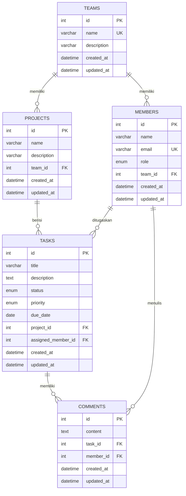

# Task Management System API

Backend REST API untuk membantu tim mengelola proyek, anggota, tugas, dan diskusi tugas. Dibangun menggunakan **NestJS, TypeScript, TypeORM, MySQL, dan class-validator**.

## 1. Fitur

- Manajemen Team: membuat, melihat, mengubah, dan menghapus tim.
- Manajemen Project: mengelola proyek di dalam sebuah tim.
- Manajemen Member: mengelola anggota tim dan perannya (`admin`, `manager`, `member`).
- Manajemen Task: membuat, melihat, memperbarui, menghapus, memfilter, dan menugaskan tugas.
- Manajemen Comment: menambahkan dan melihat komentar pada tugas.
- Validasi DTO dan parameter ID.
- Pagination untuk daftar data.
- Validasi aturan bisnis: email anggota unik, anggota yang ditugaskan harus berasal dari tim pemilik proyek.
- Logging request melalui middleware dan format response standar melalui interceptor.

> **Batasan versi ini:** autentikasi/login JWT, otorisasi berbasis token, notifikasi, dan upload file belum diimplementasikan. Endpoint komentar menerima `member_id` dari request untuk kebutuhan prototipe akademik; pada aplikasi produksi identitas ini seharusnya diambil dari pengguna yang sudah login.

## 2. Teknologi

| Komponen | Teknologi |
|---|---|
| Backend framework | NestJS |
| Bahasa | TypeScript |
| Database | MySQL 8 |
| ORM | TypeORM |
| Driver database | mysql2 |
| Validasi | class-validator, class-transformer |
| Konfigurasi | @nestjs/config, Joi |

## 3. Struktur Database dan ERD

Database bernama `task_management` terdiri dari lima tabel utama.



### Relasi dan aturan penghapusan

| Relasi | Jenis | Aturan |
|---|---|---|
| Teams → Projects | One-to-Many | Project ikut terhapus (`CASCADE`) |
| Teams → Members | One-to-Many | Member ikut terhapus (`CASCADE`) |
| Projects → Tasks | One-to-Many | Task ikut terhapus (`CASCADE`) |
| Members → Tasks | One-to-Many | Penugasan menjadi `NULL` (`SET NULL`) |
| Tasks → Comments | One-to-Many | Comment ikut terhapus (`CASCADE`) |
| Members → Comments | One-to-Many | Comment anggota ikut terhapus (`CASCADE`) |

Semua tabel menggunakan primary key `INT UNSIGNED AUTO_INCREMENT`, serta kolom `created_at` dan `updated_at`.

### Enum

- `MemberRole`: `admin`, `manager`, `member`
- `TaskStatus`: `todo`, `in_progress`, `review`, `done`
- `TaskPriority`: `low`, `medium`, `high`, `urgent`

## 4. Struktur Folder

```text
src/
├── common/
│   ├── dto/                 # DTO pagination
│   ├── enums/               # role, status, priority
│   └── utils/               # helper pagination
├── teams/
│   ├── dto/
│   ├── entities/
│   ├── teams.controller.ts
│   ├── teams.service.ts
│   └── teams.module.ts
├── projects/                # modul project
├── members/                 # modul member
├── tasks/                   # modul task
├── comments/                # modul comment
├── interceptors/            # response interceptor
├── middleware/              # request logger
├── app.module.ts
└── main.ts
```

Setiap modul domain memiliki Entity, DTO, Controller, Service, dan Module. Controller menangani HTTP request, Service menjalankan aturan bisnis, DTO memvalidasi input, dan Entity memetakan tabel database.

## 5. Instalasi dan Menjalankan

### Prasyarat

- Node.js 20 atau lebih baru
- npm
- MySQL Server 8
- Git (opsional)

### Langkah 1 — Install dependency

```bash
npm install
```

### Langkah 2 — Buat database

Buka phpMyAdmin atau MySQL CLI, lalu jalankan:

```sql
CREATE DATABASE task_management
CHARACTER SET utf8mb4
COLLATE utf8mb4_unicode_ci;
```

### Langkah 3 — Siapkan environment

Salin `.env.example` menjadi `.env`, kemudian sesuaikan password MySQL.

Windows PowerShell:

```powershell
Copy-Item .env.example .env
```

Contoh konfigurasi:

```env
PORT=3000
NODE_ENV=development
DB_HOST=localhost
DB_PORT=3306
DB_USERNAME=root
DB_PASSWORD=
DB_NAME=task_management
DB_SYNCHRONIZE=true
```

`DB_SYNCHRONIZE=true` hanya untuk pengembangan lokal. Untuk produksi, gunakan `false` dan kelola perubahan skema menggunakan migration.

### Langkah 4 — Jalankan aplikasi

```bash
npm run start:dev
```

Server berjalan di `http://localhost:3000`, sedangkan API menggunakan prefix `/api/v1`.

Tes endpoint kesehatan:

```http
GET http://localhost:3000/api/v1
```

## 6. Daftar Endpoint API

Base URL: `http://localhost:3000/api/v1`

### Teams

| Method | Endpoint | Fungsi |
|---|---|---|
| POST | `/teams` | Membuat team |
| GET | `/teams?page=1&limit=10` | Daftar team |
| GET | `/teams/:id` | Detail team dan jumlah relasi |
| PATCH | `/teams/:id` | Memperbarui team |
| DELETE | `/teams/:id` | Menghapus team |

### Projects

| Method | Endpoint | Fungsi |
|---|---|---|
| POST | `/teams/:teamId/projects` | Membuat project |
| GET | `/teams/:teamId/projects` | Daftar project |
| GET | `/teams/:teamId/projects/:id` | Detail project dan jumlah task |
| PATCH | `/teams/:teamId/projects/:id` | Memperbarui project |
| DELETE | `/teams/:teamId/projects/:id` | Menghapus project |

### Members

| Method | Endpoint | Fungsi |
|---|---|---|
| POST | `/teams/:teamId/members` | Menambah member |
| GET | `/teams/:teamId/members` | Daftar member |
| GET | `/teams/:teamId/members/:id` | Detail member |
| PATCH | `/teams/:teamId/members/:id` | Memperbarui member |
| DELETE | `/teams/:teamId/members/:id` | Menghapus member |

Query opsional: `role`, `page`, `limit`.

### Tasks

| Method | Endpoint | Fungsi |
|---|---|---|
| POST | `/projects/:projectId/tasks` | Membuat task |
| GET | `/projects/:projectId/tasks` | Daftar task |
| GET | `/projects/:projectId/tasks/:id` | Detail task dan jumlah komentar |
| PATCH | `/projects/:projectId/tasks/:id` | Memperbarui task |
| PATCH | `/projects/:projectId/tasks/:id/assign` | Menugaskan/melepas member |
| DELETE | `/projects/:projectId/tasks/:id` | Menghapus task |

Query opsional: `status`, `priority`, `assigned_member_id`, `unassigned`, `page`, `limit`.

### Comments

| Method | Endpoint | Fungsi |
|---|---|---|
| POST | `/tasks/:taskId/comments` | Menambahkan komentar |
| GET | `/tasks/:taskId/comments` | Melihat komentar |

Query opsional: `page`, `limit`. Komentar diurutkan dari yang terlama.

## 7. Contoh Request

### Membuat team

`POST /api/v1/teams`

```json
{
  "name": "Backend Team",
  "description": "Tim pengembang backend"
}
```

### Menambahkan member

`POST /api/v1/teams/1/members`

```json
{
  "name": "Budi Santoso",
  "email": "budi@example.com",
  "role": "manager"
}
```

### Membuat project

`POST /api/v1/teams/1/projects`

```json
{
  "name": "Task Management API",
  "description": "Pengembangan REST API manajemen tugas"
}
```

### Membuat task

`POST /api/v1/projects/1/tasks`

```json
{
  "title": "Membuat endpoint login",
  "description": "Menyusun endpoint autentikasi",
  "status": "todo",
  "priority": "high",
  "due_date": "2026-12-01",
  "assigned_member_id": 1
}
```

### Menambahkan komentar

`POST /api/v1/tasks/1/comments`

```json
{
  "content": "Pekerjaan siap untuk direview.",
  "member_id": 1
}
```

### Mengubah status task

`PATCH /api/v1/projects/1/tasks/1`

```json
{
  "status": "in_progress"
}
```

## 8. Validasi dan Response

ValidationPipe global menggunakan:
- `whitelist: true` untuk membuang field yang tidak didefinisikan.
- `forbidNonWhitelisted: true` untuk menolak field asing.
- `transform: true` untuk mengubah input sesuai tipe DTO.

HTTP status yang umum:
- `200`: operasi berhasil.
- `201`: data berhasil dibuat.
- `400`: input atau aturan bisnis tidak valid.
- `404`: data tidak ditemukan.
- `409`: data unik sudah digunakan.

Response sukses menggunakan format:

```json
{
  "success": true,
  "message": "Berhasil",
  "statusCode": 201,
  "data": {}
}
```

Response daftar data juga menyertakan `meta` berisi `total`, `page`, `limit`, dan `total_pages`.

## 9. Pengujian

Periksa build TypeScript:

```bash
npm run build
```

Jalankan unit test:

```bash
npm test
```

Jalankan end-to-end test:

```bash
npm run test:e2e
```

Pastikan database MySQL dan konfigurasi `.env` tersedia sebelum menjalankan endpoint yang membutuhkan database.

## 10. Pengembangan Selanjutnya

Fitur yang dapat dikembangkan setelah versi ini:
1. Autentikasi dan otorisasi menggunakan JWT.
2. Hak akses berdasarkan role admin, manager, dan member.
3. Notifikasi perubahan status dan penugasan.
4. Upload lampiran tugas.
5. Riwayat aktivitas (*activity log*).
6. Dokumentasi Swagger/OpenAPI.
7. Migration database untuk deployment produksi.
